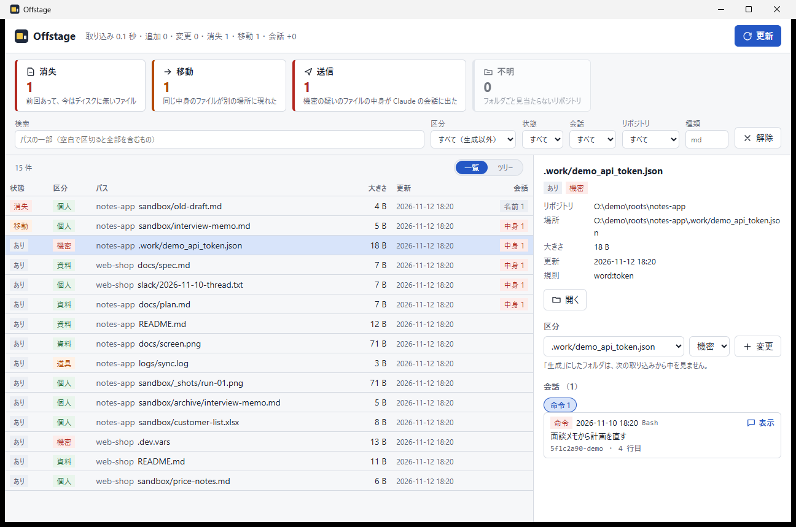
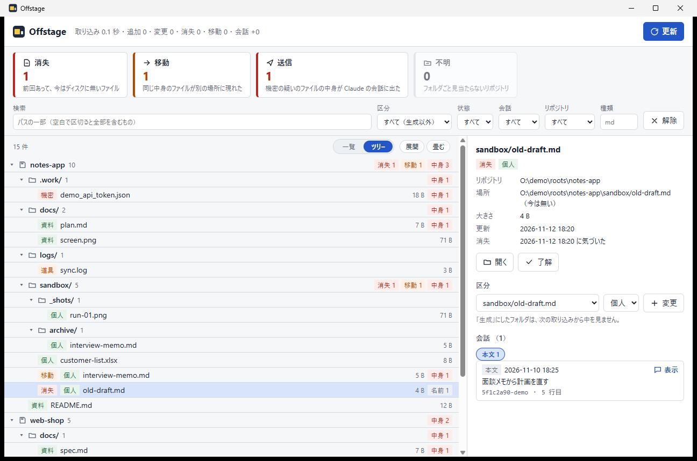
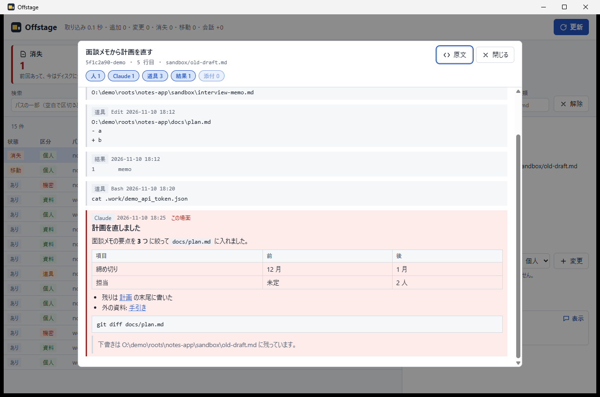

# Offstage

**git に入れていない手元のファイルを、消えたら気づき、Claude の会話に出た場面までたどれる。**

`sandbox/`・`slack/`・`.work/` のように gitignore して手元だけに置いているファイルは、git の外なので、
消しても動かしても誰も気づかず、Claude に読ませたかどうかも分からない。
Offstage はそれらをリポジトリごとに洗い出して記録し、前回と比べて消えた・動いたものに印を出す。
Claude Code の会話の記録 (`~/.claude/projects`) から、そのファイルが会話に出た場面と、中身まで送ったのか名前だけかを拾う。

[RepoTether](../../README.md) と同じリポジトリの別アプリ。探すフォルダは RepoTether の設定から借りる。



## できること

- **印** — 消失 (前回あって今は無い)・移動 (同じ中身が別の場所に現れた)・送信 (機密の疑いのファイルの中身が会話に出た)・不明 (リポジトリのフォルダごと見当たらない)。押すとその分だけに絞る
- **分類** — gitignore されたものを、名前だけで「生成物 / 機密の疑い / 道具のデータ / 個人」に分ける。中身は読まない。分け方はフォルダかファイルの単位で付け替えられる (次の取り込みからも効く)
- **資料** — git が管理している md・画像・動画・音声・Office・PDF・HTML も一緒に探せる
- **検索** — パス・区分・状態・会話 (出た / 中身 / なし / 出方)・リポジトリ・拡張子で絞る。表示は一覧とツリーを切り替える
- **会話の場面** — そのファイルが会話に出た場面を、出方 (読込・添付・検索・編集・命令・作成・結果・本文) ごとに並べる。押すと前後のやり取りを開く (Markdown は組んで表示)





## 外に出さない

- 通信しない。通信するクレートに依存せず、画面は CSP で外につながない (`ipc:` だけ)。試験で確かめている
- 記録 (`%USERPROFILE%\.offstage\index.sqlite`) にはファイル名が載るので、OneDrive などの同期フォルダの下なら開かない
- バックアップはしない。消えたことに気づくために、パス・大きさ・更新時刻・ハッシュ (個人と機密の疑いのファイルだけ) を残す。中身は残さない
- 会話の Markdown は必ず無害化し、画像は読み込まず、リンクは押しても移動しない

## 動作環境

- Windows 10 / 11 (64 bit)。WebView2
- [Git for Windows](https://gitforwindows.org/) (`git` コマンド)
- 探すフォルダは RepoTether の設定 (`%APPDATA%\com.repotether.app\config.json` の `roots` と `scanDepth`) から読む。RepoTether を使っていなければ、環境変数 `OFFSTAGE_ROOTS` (`;` 区切り) で渡す
- 会話の記録は Claude Code の `~/.claude/projects` (環境変数 `OFFSTAGE_PROJECTS` で変えられる)

## インストール

[Releases](https://github.com/lancard-aikawa/RepoTether/releases) の `offstage-v<版>` から、どちらかを入れる。

- `Offstage_<版>_x64-setup.exe` — インストーラー
- `Offstage-<版>-win-x64.zip` — 展開した `Offstage.exe` を起動するだけ

署名していないので、初回は SmartScreen が「PC が保護されました」と出す。「詳細情報」→「実行」で起動する。

## 開発

```sh
cargo test -p offstage-core -p offstage     # 試験 (通信するクレートが無いこと・CSP も)
run-offstage.bat                            # 作り直して起動 (Tauri の CLI で作る。cargo build だと画面が入らない)
```

- 取り込みと記録は [`crates/offstage-core`](../../crates/offstage-core)、画面は [`ui/`](ui) (素の HTML/JS)
- 構想と、作りながら分かったことは [docs/offstage/concept.md](../../docs/offstage/concept.md)
- README の画面は架空のリポジトリと会話で撮る: `python -I apps/offstage/tools/make_demo.py <フォルダ>` → `apps/offstage/tools/shots.ps1`
  (見本のパスが画像に出るので、`subst` で短いドライブに割り当てたフォルダで作る)

## リリース

`apps/offstage/src-tauri/Cargo.toml` と `tauri.conf.json` の版を上げ、[CHANGELOG.md](CHANGELOG.md) に節を書いてから、
`git tag offstage-v<版> && git push origin offstage-v<版>`。Actions (`release-offstage.yml`) が試験・ビルドして Release を公開する
(RepoTether の Release を「最新」のまま残すため、最新の印は付けない)。
